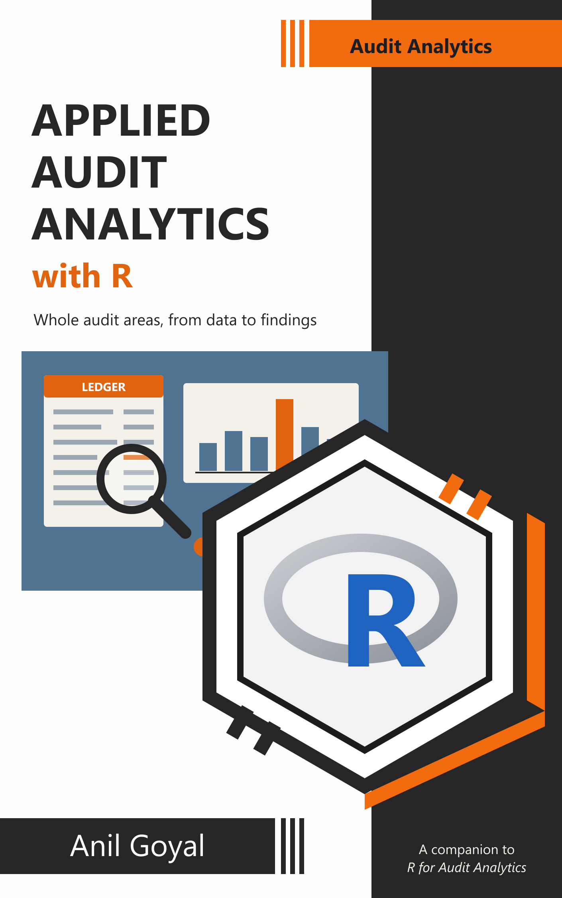

```{r}
#| include: false
source("_common.R")
```

# Welcome {.unnumbered}

<a href="https://anilyayavar.github.io/book2/index.html"></a>

This is the website of **Applied Audit Analytics with R**. It is free to read, for everyone.

It is a companion to [*R for Audit Analytics*](https://anilyayavar.github.io/new-book/). That book teaches the techniques one by one. This book applies them to whole audit areas. Real audit problems seldom fit a single technique. Each chapter here takes one audit area and brings together everything that helps with it, from simple counts to association rules, networks, record linkage and machine learning.

The book is written for auditors, in government and elsewhere, who analyse data themselves. Every chapter starts from an audit problem and ends with what the auditor does next in the field. The examples are Indian, with amounts in lakh and crore, and the data looks like what auditors actually receive.

## What is in the book {.unnumbered}

The book has four parts.

| Part | What it covers |
|-----------------------|------------------------------------------------|
| [**I. Accounts**](part1-accounts.qmd) | Journal entry testing, and reconciliation of records that should agree |
| [**II. Procurement and Payments**](part2-procurement.qmd) | Red flags in tendering, screens and models for bid rigging, and payables from the vendor master to the payment |
| [**III. Pay and Revenue**](part3-pay-revenue.qmd) | Payroll and pensions, and revenue and tax |
| [**IV. Schemes and Services**](part4-schemes.qmd) | Delays and pendency in public services, and a health insurance scheme audited from start to end |

: The four parts of the book {#tbl-parts}

## What you need first {.unnumbered}

The chapters assume you can already use R and the tidyverse. If you are new to R, start with [*R for Audit Analytics*](https://anilyayavar.github.io/new-book/). At the least, read its chapters on reading, cleaning and joining data first. You do not have to read this book in order. Each chapter stands on its own.

::: callout-note
## Links to the first book
Each chapter here uses methods taught in *R for Audit Analytics*. Rather than teach them again, the text links to the place where they are explained. Links that leave this book carry a small arrow, like this [Benford Analysis](https://anilyayavar.github.io/new-book/17-Anamolous.html). Most of them open the first book, and their chapter and section numbers are those of the first book. Links without the arrow stay within this book.
:::

## How the chapters are written {.unnumbered}

- **An audit area** comes first. The chapter lists the records that matter, and how money leaks through them.
- **Data with planted cases.** Real audit data cannot be shared. So each chapter creates realistic data in R, and *plants* in it the irregularities to be found, along with innocent cases that look similar. The code that creates the data is folded away. Click on it to see it. Every number quoted in the text is computed from the data, so the text and the results always agree.
- **Tests, then a risk view.** The chapter runs its tests one by one, and then counts the flags for each vendor, employee, dealer or hospital.
- **Audit use cases** follow one or two cases to the end, and say what the auditor does next.
- **Callouts** mark what matters most for audit. A suggested workflow, exercises and a summary of functions close each chapter.

The packages needed are listed in @sec-packages, and the datasets are described in @sec-datasets. The Audit Question Finder in @sec-finder lists common audit questions and the section that answers each one.

## Licence, disclaimer and feedback {.unnumbered}

This book by Anil Goyal is licensed under [CC BY-NC 4.0](https://creativecommons.org/licenses/by-nc/4.0/). You may share and adapt it for non-commercial purposes, with credit to the author.

The author works for the Government of India. The opinions expressed in the book are personal to the author, and are not to be construed as those of the Government of India. All data in the book is simulated by the author. None of it pertains to any entity handled by the author in his official capacity. Rules, rates and limits in the chapters are examples. Apply the actual rules of your own government.

Suggestions and corrections are welcome, by [email](mailto:anilyayavar@gmail.com) or through the [issues](https://github.com/anilyayavar/book2/issues) of the book's repository.
